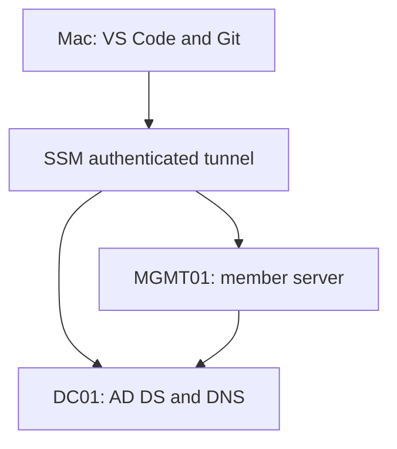

# Systems Administration Labs

**Guot Deng Anyak | Windows, Linux, AWS, networking and automation**

Hands-on infrastructure practice alongside the AI Infrastructure Incident Assistant project.
The first track builds a self-managed Active Directory domain on two Windows Server EC2
instances. It covers DNS, PowerShell user provisioning, domain membership, Group Policy
and incident investigation. Later tracks cover Linux, DHCP/NAT, AWS operations and automation.

**Status: lab materials prepared; environment not deployed; exercises not yet completed.**
No production experience, success metrics or completed lab outcomes are implied by these files.

## Start here

1. Read [START-HERE.md](START-HERE.md).
2. Run `bash scripts/mac-inventory.sh` on your Mac (read-only).
3. Follow [AWS environment setup](docs/aws-setup.md) to launch only when ready for charges.
4. Work through the [Active Directory track](windows/active-directory/README.md).
5. Add actual evidence using [the report template](templates/lab-report.md).
6. Follow [GitHub publishing](docs/github-publishing.md).

## Portfolio tracks

| Track | Scope | Current status |
|---|---|---|
| Windows / Active Directory | AD DS, DNS, 150 synthetic accounts / five OUs, domain join, GPO, troubleshooting | Instructions and scripts prepared; execution pending |
| Linux | Users, permissions, systemd, storage, patching, logs, backup/restore | Planned |
| Networking | DHCP scopes/leases, isolated routing/NAT, DNS and firewall faults | Planned |
| AWS operations | EC2, IAM, monitoring, backups and incident investigation | Planned |
| Automation | PowerShell, Bash and Python operational tasks | AD starter scripts prepared; execution pending |

The [roadmap](docs/roadmap.md) preserves all agreed labs without changing the existing
12-week AI engineering program. Start with one administration session per week.

## Lab design

- `DC01`: Windows Server 2025, AD DS and DNS, `10.77.10.10`.
- `MGMT01`: Windows Server 2025 member server, `10.77.10.20`.
- Domain: `ad.guotlab.test`; NetBIOS: `GUOTLAB`.
- AWS subnet: `10.77.10.0/24` within lab VPC `10.77.0.0/16`.
- SSM port forwarding for RDP; no public inbound security-group rules.
- Two x86 instances, encrypted EBS, IMDSv2; public IPs supply outbound internet access.

This is an isolated learning environment, not a highly available production design.
Internal security-group traffic is intentionally broad between only these two lab machines.
Windows Firewall remains enabled; later exercises examine narrower rules.
A server member provides domain-join practice, but is not a Windows 11 workstation.

## What has been checked

See [VALIDATION.md](VALIDATION.md) for exact checks and limits. AWS deployment, Windows
execution and domain authentication must be verified in the learner's environment.

## Completed lab results

See [verified Active Directory lab results](docs/completed-ad-lab.md).
