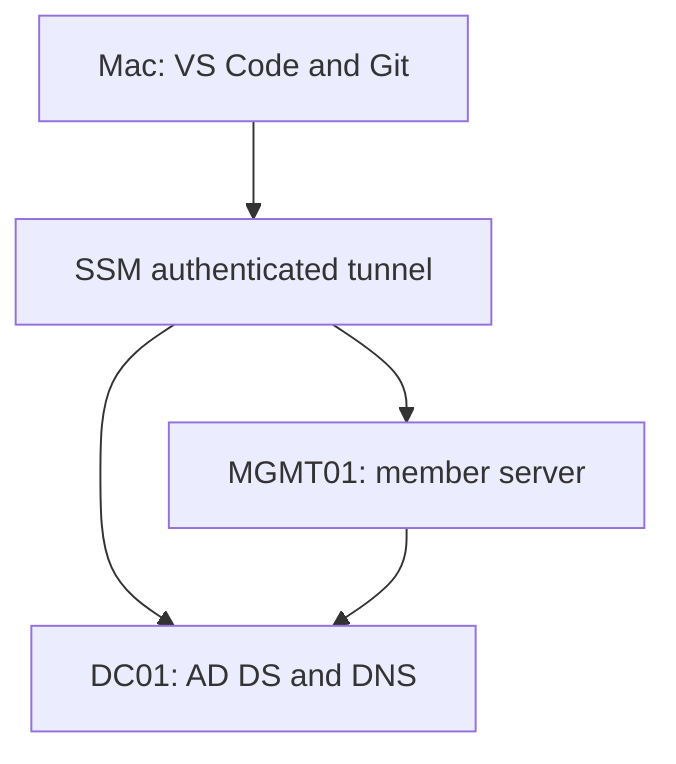

# Systems Administration Labs

**Guot Deng Anyak | Windows, Linux, AWS, networking and automation**

I build and troubleshoot infrastructure in these labs alongside my AI Infrastructure Incident Assistant project.
The first track builds a self-managed Active Directory domain on two Windows Server EC2
instances. It covers DNS, PowerShell user provisioning, domain membership, Group Policy
and incident investigation. Later tracks cover Linux, DHCP/NAT, AWS operations and automation.

**Status: I deployed Active Directory, provisioned users, joined the member server
and verified the initial Group Policy exercise on October 19, 2026. On October 20,
I reproduced, diagnosed and repaired a DNS fault on MGMT01. I also recovered the
disabled labuser002 account and verified its domain credentials from MGMT01.
Additional validation and recovery exercises remain.**

Read the [completed lab results](docs/completed-ad-lab.md) and the
[published Group Policy evidence excerpt](evidence/published/labuser001-group-policy.txt).
The [DNS incident report](docs/incidents/2026-10-20-mgmt01-dns-recovery.md) documents a
failed lookup, resolver comparison, repair and domain-connectivity checks.
The [disabled-account recovery report](docs/incidents/2026-10-20-labuser002-account-recovery.md)
records how I checked the account, recovered it and confirmed domain credential validation.

## Terraform deployment portfolio

The [Terraform AWS network deployment lab](practice/terraform-network-live/README.md)
provides a separate create, verify, update, drift and cleanup walkthrough with
mock-provider checks. It uses a dedicated VPC range and its own local state.
**Status: initial deployment completed October 25, 2026; five resources tracked and a no-change follow-up plan verified from supplied terminal output. Tag updates, drift and cleanup evidence remain pending.**
See the [evidence checklist](practice/terraform-network-live/EVIDENCE.md).
The existing Windows AD environment remains managed by CloudFormation.

## Start here

1. Read [START-HERE.md](START-HERE.md).
2. Run `bash scripts/mac-inventory.sh` on your Mac (read-only).
3. Follow [AWS environment setup](docs/aws-setup.md) to launch only when ready for charges.
4. Work through the [Active Directory track](windows/active-directory/README.md).
5. Add actual evidence using [the report template](templates/lab-report.md).
6. Follow [GitHub publishing](docs/github-publishing.md).

## Portfolio tracks

| Track | Scope | Current status |
|---|---|---|
| Windows / Active Directory | AD DS, DNS, 150 synthetic accounts / five OUs, domain join, GPO, troubleshooting | Core deployment, user counts, domain join, first GPO, DNS fault recovery and disabled-account recovery verified; further recovery planned |
| Linux | Users, permissions, systemd, storage, patching, logs, backup/restore | Planned |
| Networking | DHCP scopes/leases, isolated routing/NAT, DNS and firewall faults | Planned |
| AWS operations | EC2, IAM, monitoring, backups and incident investigation | Lab infrastructure deployed with CloudFormation and accessed through SSM; further operations exercises planned |
| Automation | PowerShell, Bash and Python operational tasks | PowerShell CSV user provisioning executed; further automation planned |

The [roadmap](docs/roadmap.md) preserves all agreed labs without changing the existing
12-week AI engineering program. Administration sessions are on Tuesdays and Thursdays;
AI engineering sessions are on Mondays, Wednesdays and Fridays.

## Lab design

- `DC01`: Windows Server 2025, AD DS and DNS, `10.77.10.10`.
- `MGMT01`: Windows Server 2025 member server, `10.77.10.20`.
- Domain: `ad.guotlab.test`; NetBIOS: `GUOTLAB`.
- AWS subnet: `10.77.10.0/24` within lab VPC `10.77.0.0/16`.
- SSM port forwarding for RDP; no public inbound security-group rules.
- Two x86 instances, encrypted EBS, IMDSv2; public IPs supply outbound internet access.

This is an isolated learning environment, not a highly available production design.
Internal security-group traffic is intentionally broad between only these two lab machines.
Windows Firewall remains enabled; later exercises examine narrower rules.
A server member provides domain-join practice, but is not a Windows 11 workstation.

## Validation

[VALIDATION.md](VALIDATION.md) distinguishes starter-package checks, observed lab results
and checks still pending. [Published evidence](evidence/published/README.md) includes
labeled excerpts of my Group Policy, DNS troubleshooting and disabled-account recovery results.
