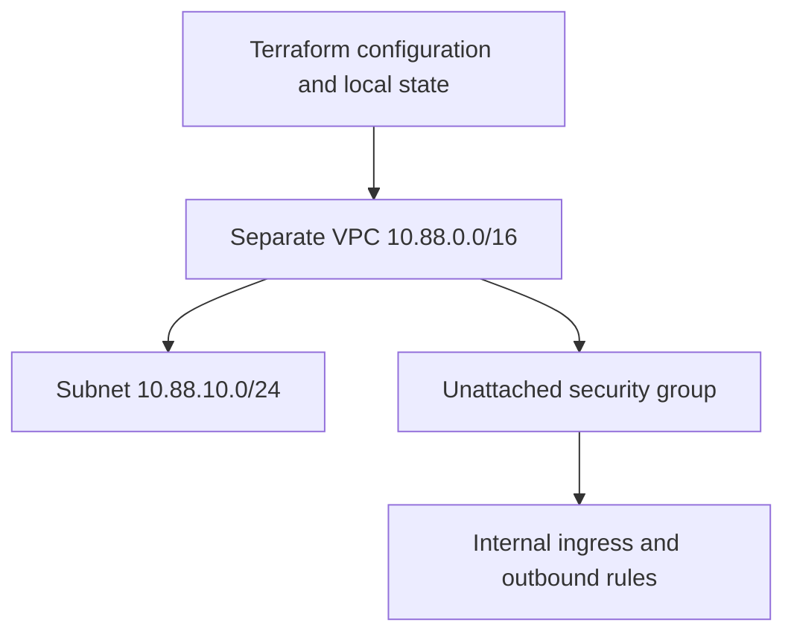

# Terraform AWS network deployment lab

**Status: initial AWS deployment completed October 25, 2026. Supplied terminal output confirms five resources added, five resource addresses in state and a no-change follow-up plan. Tag updates, drift and cleanup remain pending.**

I am extending my Terraform mock-plan practice into a small end-to-end AWS learning deployment. The goal is to explain infrastructure decisions, review changes, inspect state, detect drift and clean up resources for Cloud Operations Engineer interview preparation.

See [EVIDENCE.md](EVIDENCE.md) for recorded results and remaining checkpoints. The full lifecycle exercise is still in progress; this is learning experience rather than production work.

## Scope and isolation

This directory has its own local Terraform state. It defines five Terraform-managed resources: a VPC, subnet, security group, self-referencing ingress rule and outbound rule. AWS also supplies default VPC components; these are not separate resource blocks in this configuration.

- Dedicated VPC: 10.88.0.0/16; subnet: 10.88.10.0/24.
- Original AD lab: 10.77.0.0/16, owned by CloudFormation and unchanged here.
- No peering or shared references connect the two environments.
- No EC2, EBS, IAM, NAT gateway, internet gateway, endpoints or public IPv4 addresses.
- Subnet public-IP auto-assignment is disabled.
- Inbound traffic is limited to members of this lab's security group.
- Outbound all-protocol permission does not provide internet routing.
- No imports or data sources adopt existing lab resources.

The group is unattached in this network-only lab. This demonstrates infrastructure lifecycle, not application reachability, patching or a usable AD environment.

AWS documents no additional charge for the VPC itself or security groups. Some VPC features and public IPv4 addresses incur charges. This configuration omits those billable components; it does not guarantee that your overall account bill is zero, and your existing Windows hosts may still be billable.

## Architecture



## 1 Prepare locally

Use your personal learning account, not an employer or production account. Your AWS principal needs the relevant EC2 networking describe, create, tag, rule-management and delete permissions. Authentication alone does not establish those permissions. Do not use root credentials or broaden access merely to bypass an error.

Use the existing AWS CLI authentication mechanism; do not place access keys in Terraform files. Do not change the mock exercise's all-zero account guard.

From the repository root, inspect local work before switching branches:

```bash
git status --short
git fetch origin
git switch --track origin/practice/terraform-network-live
cd practice/terraform-network-live
pwd
```

If Git reports conflicting local changes from previous exercises, stop and preserve them before switching; do not reset or discard them. If this branch already exists locally, use git switch practice/terraform-network-live instead of --track.

Verify the target identity locally:

```bash
aws login --profile admin-lab --region us-east-1
aws sts get-caller-identity --profile admin-lab --region us-east-1
```

The login command matches the profile mechanism used in the existing lab; other profile types may use a different sign-in command. Check the account yourself. Do not publish the full identity output.

Copy the example, then replace the account placeholder with your verified lab account ID:

```bash
cp terraform.tfvars.example terraform.tfvars
open -a "Visual Studio Code" terraform.tfvars
```

The provider checks allowed_account_ids against this input. This is an account guard, not a resource-level permission boundary. Do not put existing VPC IDs in the configuration, copy AD state here or configure an existing production backend.

## 2 Validate and predict

```bash
terraform init -input=false
terraform fmt -recursive
terraform fmt -check -recursive
terraform validate
terraform test -verbose
```

Initialization uses the default local backend; this directory declares no remote backend. The three mock tests use a synthetic account value and explicit command = plan. CI does not receive AWS credentials or deploy anything.

Prediction: the dedicated CIDRs remain distinct, no public IP is assigned and only five resource blocks are involved. Tests passing does not prove your live AWS permissions or quotas are sufficient.

## 3 Review a live creation plan

```bash
terraform plan -out=create.tfplan
terraform show -no-color create.tfplan
```

Stop unless the reviewed plan contains exactly the expected five additions, zero changes and zero destructions. Confirm the profile/account, region, directory, tags and dedicated CIDRs. Unexpected replacement or any reference to the Windows lab requires investigation.

Saved plans can contain sensitive data; keep them out of Git. If configuration or relevant inputs change, generate a new plan. Applying a saved plan executes its actions without the normal interactive approval prompt.

## 4 Deploy and inspect

Only after reviewing and accepting this specific creation plan, run locally:

```bash
terraform apply create.tfplan
terraform output
terraform state list
terraform plan
```

Expected: apply reports five resources added; state lists only the five resources from this folder; the follow-up normal plan reports no changes. If an apply partially fails, inspect state and the error before retrying. Preserve state; deleting it can orphan resources.

In the AWS console, use us-east-1 and locate resources by Project = guot-tf-network-live. Verify the VPC CIDR and DNS attributes, subnet CIDR and public-IP setting, group rule directions and source. Confirm the AD lab remains separate.

Record sanitized actual results in EVIDENCE.md; never invent IDs or completion dates.

## 5 Make a controlled update

Change only environment in your local terraform.tfvars from learning to interview-practice. Predict which tags will change before planning.

```bash
terraform fmt -recursive
terraform validate
terraform plan -out=tag-update.tfplan
terraform show -no-color tag-update.tfplan
```

Expect tag updates to the VPC, subnet and group, with no creates, destroys or replacements. The standalone rules do not use common_tags in this configuration. After reviewing and accepting the scope:

```bash
terraform apply tag-update.tfplan
terraform plan
```

Confirm the new tags in AWS and a no-change follow-up plan. Explain why the tag update does not require server or subnet replacement.

## 6 Detect deliberate drift

In the console, identify only the newly created practice VPC using its Terraform output and Project tag. Change that VPC's Environment tag to accidental-test. Do not edit any Windows lab resource or security rule.

```bash
terraform plan -refresh-only
terraform plan -out=restore-tag.tfplan
terraform show -no-color restore-tag.tfplan
```

Refresh-only planning reviews observed differences for state. The normal plan should propose restoring this VPC tag to interview-practice. Neither plan applies its changes. Do not use terraform refresh.

After confirming the restoration plan contains only the intended tag correction:

```bash
terraform apply restore-tag.tfplan
terraform plan
```

Explain whether the console change was intentional and why configuration should remain the source of the intended value here. Save a sanitized diff excerpt, not a plan binary or state file.

## 7 Clean up only this directory's resources

Keep the same account, profile, region, local inputs and state. Check state addresses and review a destroy plan:

```bash
terraform state list
terraform plan -destroy -out=cleanup.tfplan
terraform show -no-color cleanup.tfplan
```

Stop unless it proposes removing only this exercise's five tracked resources. Do not run cleanup from the Windows lab directory or point it at unrelated state. Do not attach Windows instances to this practice network.

After reviewing and accepting that exact cleanup:

```bash
terraform apply cleanup.tfplan
terraform state list
terraform plan -destroy
```

Expect empty resource state and no further destroy actions. Verify the practice VPC and group are gone in AWS. Retain local state until cleanup is confirmed. Do not run a normal apply after cleanup: configuration still describes resources and would propose recreating them.

Record cleanup date and actual results. Commit only sanitized evidence, configuration and the dependency lock file.

## Interview checkpoints

1. Why use a different CIDR and a separate state directory?
2. What does allowed_account_ids protect, and what does it not protect?
3. Why does matching the AD VPC's Name tag not import it?
4. Which resource references establish dependencies?
5. Why is there no internet access despite an outbound rule?
6. What does a tag-only plan look like?
7. What does refresh-only planning review compared with a normal plan?
8. Why must a new plan be generated after configuration changes?
9. What do you do if apply fails halfway through?
10. How do you prove cleanup without touching the CloudFormation lab?

This supplements the existing study plan; it does not change the 12-week AI engineering program.

## References

- [HashiCorp AWS lifecycle tutorials](https://developer.hashicorp.com/terraform/tutorials/aws-get-started)
- [Provider mocking](https://developer.hashicorp.com/terraform/language/tests/mocking)
- [AWS VPC pricing](https://aws.amazon.com/vpc/pricing/)
- [AWS security groups](https://docs.aws.amazon.com/vpc/latest/userguide/vpc-security-groups.html)
